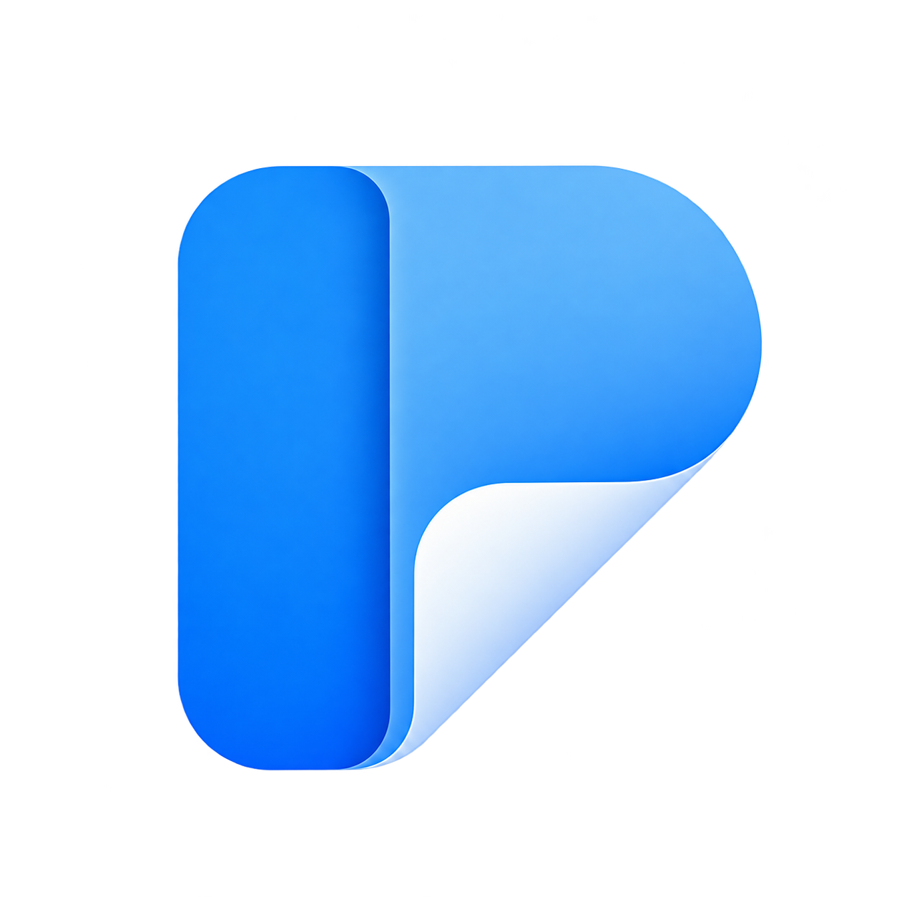
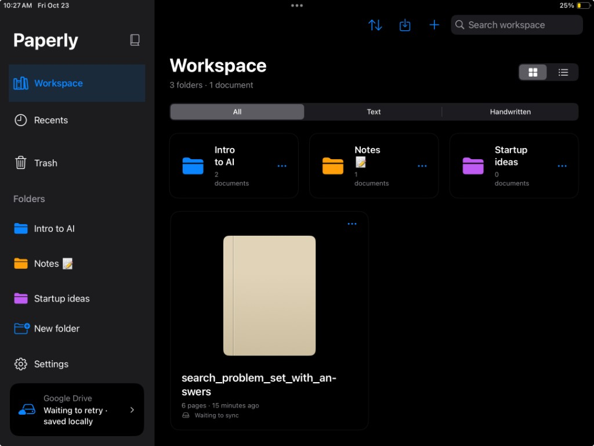
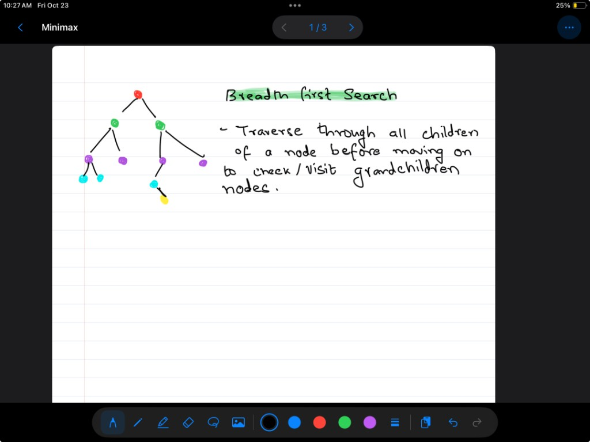
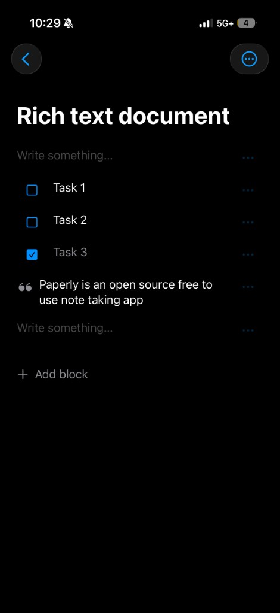
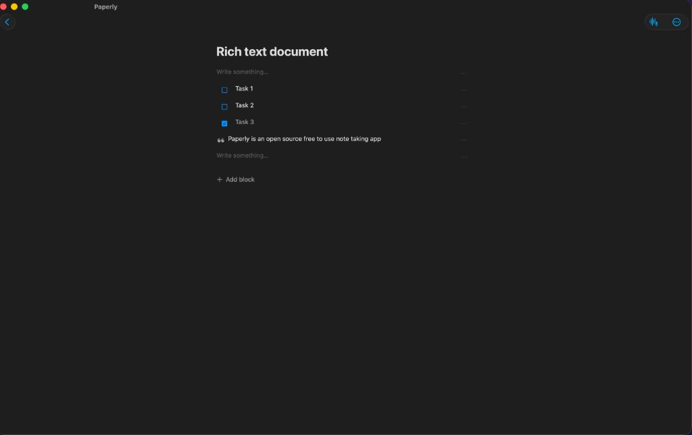
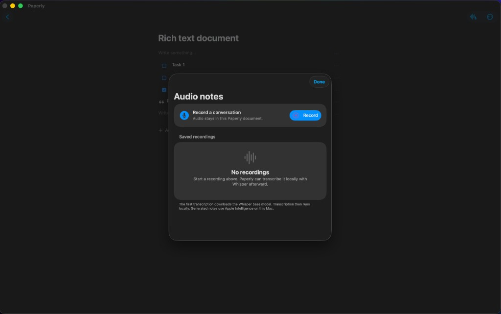

<p align="center">
  
</p>

<h1 align="center">Paperly</h1>

<p align="center">
  A private, offline-first notebook for iPhone, iPad, and Mac.<br>
  Write, draw, annotate PDFs, and turn recordings into structured notes.
</p>

<p align="center">
  
  
  
  
</p>

<p align="center">
  <strong>Free and open source.</strong> No Paperly account, cloud AI, analytics, advertising, or subscription.
</p>

<p align="center">
  <a href="#features">Features</a> ·
  <a href="#screenshots">Screenshots</a> ·
  <a href="#getting-started">Getting started</a> ·
  <a href="#mac-audio-notes">Mac audio notes</a> ·
  <a href="#contributing">Contributing</a>
</p>

---

<p align="center">
  
</p>

## Download

| Download | Use |
| --- | --- |
| [**Latest unsigned IPA**](../../releases/latest/download/Paperly-unsigned.ipa) | Re-sign and install Paperly on your own iPhone or iPad |
| [**Mac development build**](../../releases/latest/download/Paperly-Mac-development.zip) | Apple Development–signed universal Mac app for registered test Macs; not notarized |
| [**All releases**](../../releases) | Release notes and previous builds |
| [**Source code**](../../archive/refs/heads/main.zip) | Build Paperly yourself with Xcode |

The release IPA is precompiled but intentionally unsigned. iOS will not install it directly: re-sign it with your own Apple ID, development certificate, or provisioning profile using Xcode or a compatible sideloading tool. Enable Developer Mode on the target device. Free personal-team signatures normally expire after seven days; paid Apple Developer signatures follow the associated profile.

Release builds use placeholder Google OAuth values and do not include the maintainer's Google Cloud configuration. To use optional Drive sync, build from source with your own iOS OAuth client.

## What is Paperly?

Paperly is a native Apple-platform notebook that keeps typed documents, handwritten pages, PDFs, images, and recordings in one portable workspace.

The app saves locally first. Handwriting recognition uses Apple Vision, transcription uses WhisperKit, and supported Apple Intelligence features use Foundation Models on the device. Google Drive is available as an optional backup and sync destination; local editing does not depend on an account or network connection.

Paperly is built with Swift 6, SwiftUI, UIKit, PencilKit, PDFKit, GRDB, WhisperKit, and Google Sign-In.

## Features

### Notes and organization

- Block-based text documents with headings, lists, checkboxes, quotes, and code blocks
- Handwritten multi-page notebooks with Blank, Ruled, Grid, and Dot paper
- Folder-first workspace, grid/list views, sorting, search, recents, and recoverable Trash
- Tactile notebook covers and configurable folder colors
- Markdown, PDF, and editable `.paperly` import/export

### Handwriting and PDFs

- Native PencilKit drawing with pen, pencil, marker, eraser, lasso, colors, and widths
- Fountain, Ball, and Brush pen profiles
- Page-by-page or continuous navigation with vertical and horizontal scrolling
- Editable images positioned beneath ink
- PDF import with editable annotation while preserving the original source pages
- On-device handwriting search powered by Apple Vision

### Audio intelligence

- Record audio notes on supported iPhone and Mac hardware
- Live waveform and recording status
- Local transcription with WhisperKit
- Convert transcripts into headings, paragraphs, lists, and checkboxes with Apple Intelligence
- Keep the recording, transcript, and generated blocks inside the Paperly document
- Dynamic Island and Live Activity status during iPhone recording and processing

### Offline and portable

- Local-first atomic document saves
- No Paperly backend, Firebase, analytics, advertising, or cloud AI
- Optional Google Drive backup and cross-device sync
- Conflict preservation instead of silent overwrites
- Portable, versioned `.paperly` documents

## Screenshots

<p align="center">
  
</p>

<p align="center"><strong>Native handwriting on iPad</strong><br><sub>Editable PencilKit ink, page templates, colors, drawing tools, and page navigation.</sub></p>

<table>
  <tr>
    <td width="35%" align="center">
      
    </td>
    <td width="65%" align="center">
      
    </td>
  </tr>
  <tr>
    <td align="center"><strong>iPhone</strong><br><sub>Capture and edit structured notes anywhere.</sub></td>
    <td align="center"><strong>Mac</strong><br><sub>Work in a focused, native desktop editor.</sub></td>
  </tr>
</table>

## Mac audio notes

Paperly runs on Mac through Mac Catalyst. Open a text document and choose **Audio notes** to record a conversation, transcribe it locally, and convert the result into editable Paperly blocks.

<p align="center">
  
</p>

The first transcription downloads WhisperKit's base model. After that, transcription runs locally. Note generation requires macOS 26 or later with Apple Intelligence supported, enabled, and ready. Audio, transcripts, and generated notes remain part of the document and are included in editable `.paperly` exports.

## Requirements

| Component | Requirement |
| --- | --- |
| Development | Xcode 16.3 or later; Swift 6 |
| iPhone and iPad | iOS or iPadOS 17 or later |
| Mac | Mac Catalyst |
| Handwriting | Apple Pencil is optional; finger input is supported |
| Generated audio notes | Compatible Apple Intelligence hardware and software |
| Google Drive | Optional OAuth client configuration |

## Getting started

1. Clone or download this repository.
2. Open `Paperly.xcodeproj` in Xcode.
3. Select the **Paperly** scheme.
4. In **Signing & Capabilities**, choose your development team and use a unique bundle identifier if required.
5. Select an iPhone, iPad, simulator, or **My Mac (Mac Catalyst)**.
6. Press <kbd>⌘R</kbd>.

Swift Package Manager resolves the project dependencies automatically:

- [GRDB.swift](https://github.com/groue/GRDB.swift)
- [WhisperKit](https://github.com/argmaxinc/WhisperKit)
- [Google Sign-In for iOS and macOS](https://github.com/google/GoogleSignIn-iOS)

### Physical iPhone or iPad

Trust the connected device, enable **Settings → Privacy & Security → Developer Mode**, restart when prompted, and select the device in Xcode. Microphone access is requested only when starting an audio recording.

### Mac

The downloadable ZIP contains a development-signed app for Apple silicon and Intel Macs. It is not notarized and requires a Mac included in its development provisioning profile while that profile remains valid. Other Macs should build from source and select their own signing team. This is a testing build, not a public Developer ID installer.

Select **My Mac (Mac Catalyst)** as the destination. Open a text document and use the waveform button to access Audio notes.

### Optional Google Drive setup

Paperly works without Google credentials. To enable Drive backup and sync, create a gitignored `Config.local.xcconfig`, follow the [Google OAuth setup guide](docs/GoogleOAuth.md), and provide your own public client ID. Never commit local OAuth configuration or signing material.

## Build and test

The generated Xcode project is committed. If you change `project.yml`, install [XcodeGen](https://github.com/yonaskolb/XcodeGen) and regenerate it:

```sh
brew install xcodegen
xcodegen generate
```

Run the portable model tests and an unsigned simulator build:

```sh
export DEVELOPER_DIR=/Applications/Xcode.app/Contents/Developer

swift test

xcodebuild \
  -project Paperly.xcodeproj \
  -scheme Paperly \
  -destination 'generic/platform=iOS Simulator' \
  CODE_SIGNING_ALLOWED=NO \
  build
```

Run the app test suite on an installed simulator:

```sh
xcodebuild \
  -project Paperly.xcodeproj \
  -scheme Paperly \
  -destination 'platform=iOS Simulator,name=iPad Pro 13-inch (M5)' \
  CODE_SIGNING_ALLOWED=NO \
  test
```

See [Validation](docs/Validation.md) for tested behavior and hardware boundaries.

### Publishing an unsigned IPA

Pushing a version tag runs `.github/workflows/release-ipa.yml`, builds the iPhone/iPad app without maintainer signing credentials, creates `Paperly-unsigned.ipa`, and attaches it to a GitHub Release:

```sh
git tag v1.0.0
git push origin v1.0.0
```

The **Latest unsigned IPA** link above always targets the asset from the newest GitHub Release.

## Project structure

```text
Paperly/
├── App/          App lifecycle and shared environment
├── Audio/        Recording, WhisperKit, and Foundation Models integration
├── Editor/       PencilKit notebook editor, tools, images, and page navigation
├── Library/      Workspace, folders, recents, search, and Trash
├── Models/       Portable document formats and shared Foundation models
├── PDF/          PDF import, display, and annotated export
├── Search/       On-device Vision handwriting recognition
├── Settings/     App preferences and optional services
├── Storage/      Local repository, atomic writes, and GRDB metadata
├── Sync/         Optional Google Drive synchronization
└── Text/         Block document editor, history, and Markdown export
```

Additional targets:

- `PaperlyWidgets` — Home Screen and Lock Screen widgets plus Live Activities
- `PaperlyTests` — iOS/iPadOS integration tests
- `CoreTests` — portable document-model tests
- `Samples` — importable example `.paperly` files

## Document format and privacy

Paperly documents are versioned and portable. Committed local content survives relaunch, and conflicting sync revisions are preserved for review. Read the [document format and crash-recovery notes](docs/DocumentFormat.md) for details.

Recognition and intelligence features process content on-device:

- Apple Vision indexes saved handwriting for search.
- WhisperKit transcribes recordings locally after its model is available.
- Apple Foundation Models creates structured notes on supported devices.
- Google receives document data only when the user explicitly configures and uses Drive sync.

## Contributing

Contributions are welcome.

1. Create a branch for one focused change.
2. Follow the existing SwiftUI/UIKit architecture and local-first storage model.
3. Add or update tests for behavior changes.
4. Run `swift test` and the relevant Xcode build/tests.
5. Open a pull request describing the user-visible change and validation performed.

Please do not add analytics, advertising SDKs, cloud AI dependencies, or a mandatory account flow. Those conflict with Paperly's privacy and offline-first goals.

For larger changes, open a discussion before implementation so the document format, sync behavior, and platform experience can be considered together.

## Documentation

- [Document format and recovery](docs/DocumentFormat.md)
- [Google OAuth and Drive sync](docs/GoogleOAuth.md)
- [Validation record](docs/Validation.md)

## License

Paperly is available under the [MIT License](LICENSE).
